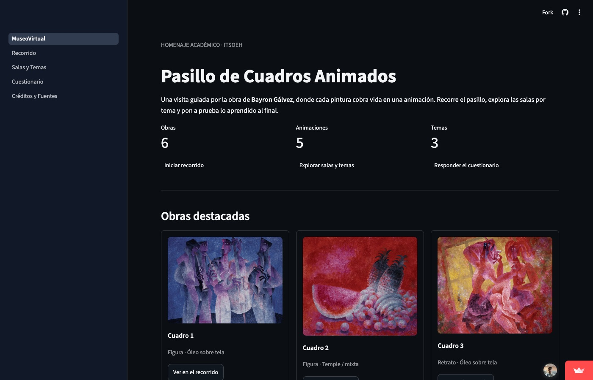

# Virtual Museum — Animated Paintings Gallery

Interactive museum about the work of painter Bayron Gálvez. Each painting comes to life as a short animation, and the tour ends with a quiz to test what visitors learned. The interface is in Spanish.

**[Open the live app →](https://alex-calva-museo-virtual.streamlit.app)**

## Features

- **Home:** collection stats, featured works and quick links to each section.
- **Tour:** step through the hallway work by work, with the painting, its animation, an audio guide when available and a technical sheet.
- **Rooms and themes:** filter the collection by theme, technique or keyword, and jump from any result to its place in the tour.
- **Quiz:** five questions with instant feedback, a running score and a reset button.
- **Credits and methodology:** how the animations were produced and compressed.

## Tech Stack

Python · Streamlit · FFmpeg (H.264) · Streamlit Community Cloud

## Source Code

The source code is kept in a private repository. It can be shared on request.

---

> University project, ITSOEH.

**Author:** Rembrandt Alexander Calva Obregón · [Portfolio](https://alex-calva.github.io) · [LinkedIn](https://www.linkedin.com/in/alex-calva)
